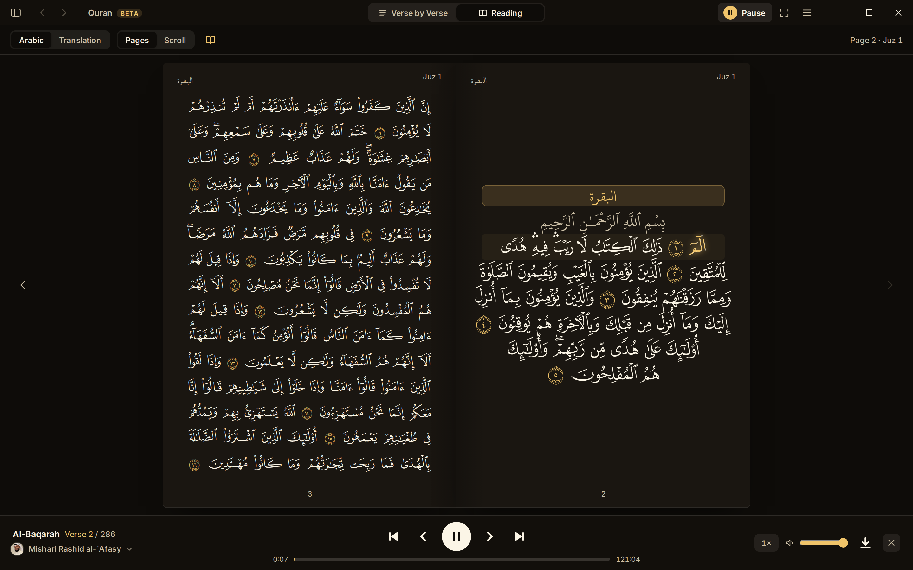
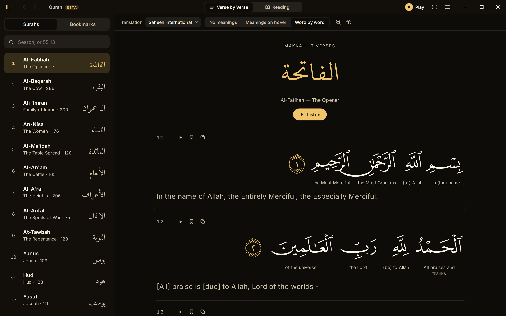
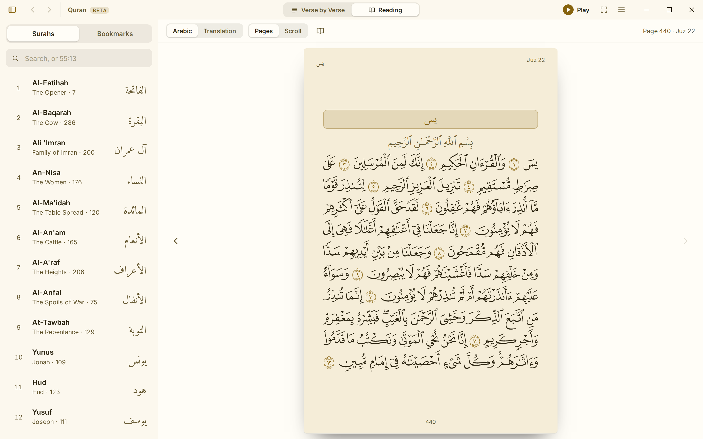
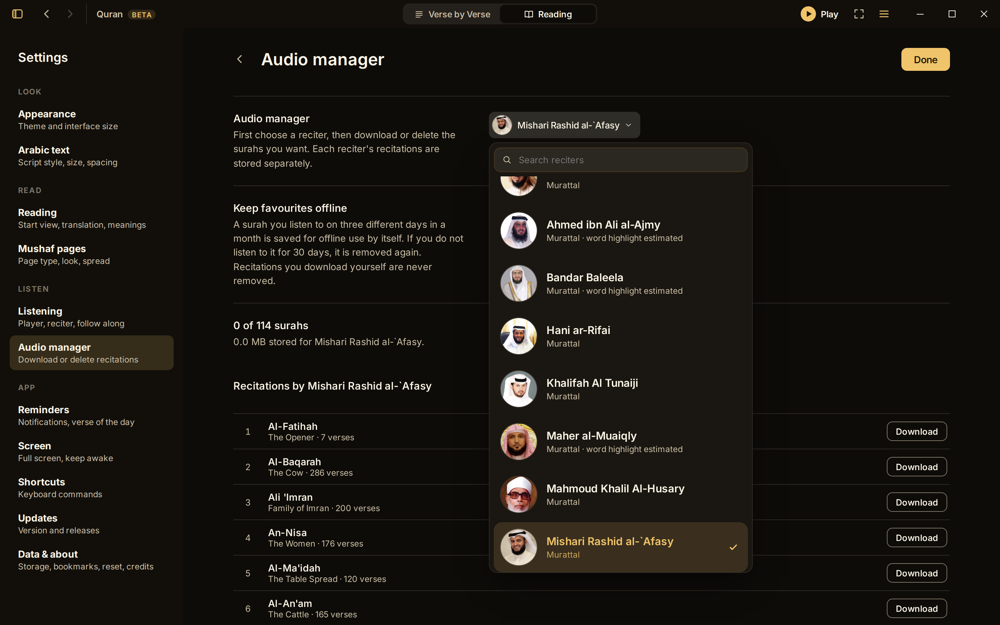
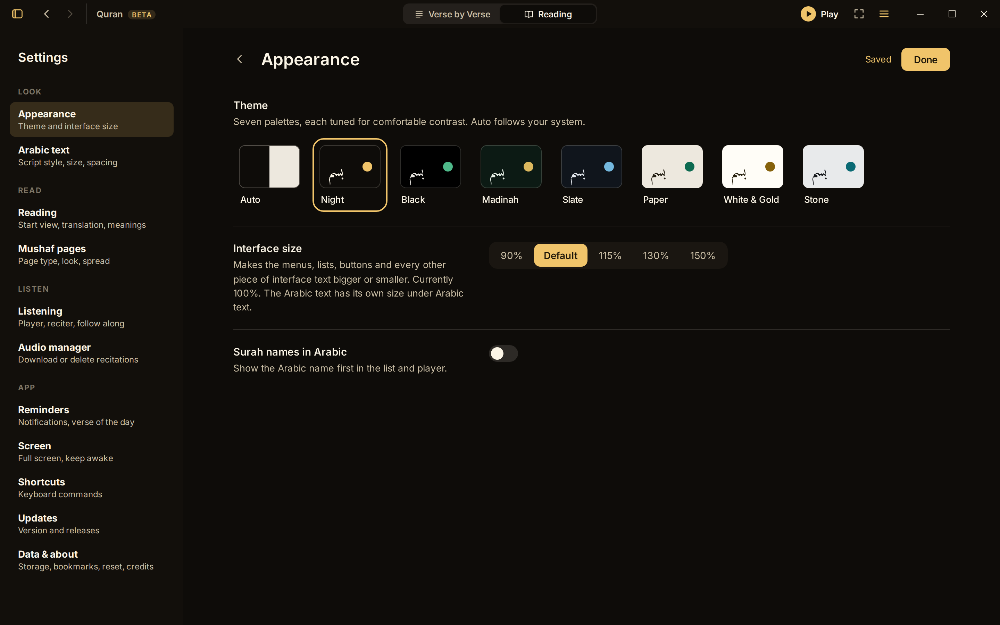
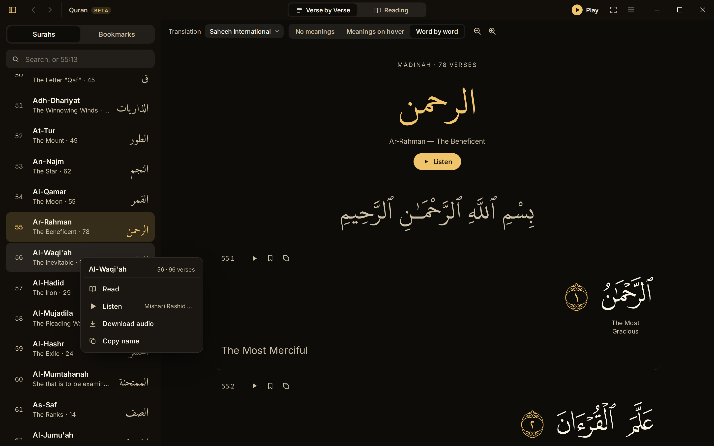
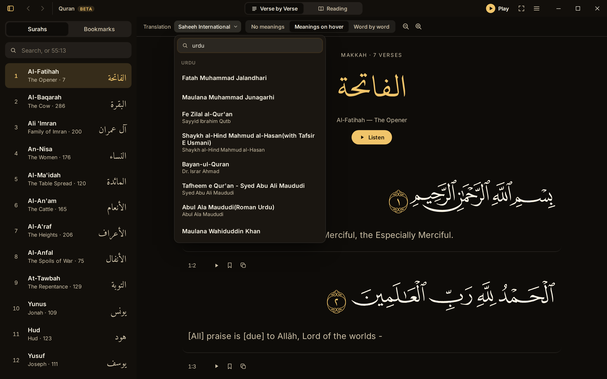

<div align="center">


# Quran for Desktop

**A free, open-source Quran app for Windows and macOS.**<br/>
Read the exact printed Mushaf, follow the recitation word by word, and keep everything offline.

[](https://github.com/Obscyra/quran-desktop/releases)

[](https://github.com/Obscyra/quran-desktop/releases)
[](#download)
[](LICENSE)
[](https://tauri.app)

<sub>Looking for the Android app? See <a href="https://github.com/quran/quran_android">Quran for Android</a>.</sub>

<br/>



</div>

<br/>

## Why this app

- **Reading comes first.** It opens as a Quran to read. Listening is one click away and never in the way.
- **The real Mushaf.** Every page is drawn in its own per-page font, so each line matches the printed Madani Mushaf glyph for glyph.
- **Free for good.** No ads, no accounts, no paid features, no tracking.

## Download

Get the installer for your system from the **[Releases page](https://github.com/Obscyra/quran-desktop/releases)**.

| System | File | Notes |
| --- | --- | --- |
| Windows 10 / 11 | `Quran_<version>_x64-setup.exe` | Installs for your user only, no administrator rights needed. Windows SmartScreen may warn because the app is not code-signed yet: choose **More info → Run anyway**. |
| macOS | `Quran_<version>_universal.dmg` | Built automatically for Apple silicon and Intel. Not yet tested on a Mac by the maintainer. |

> **This is a beta.** Please report anything that looks wrong, especially in the Arabic text, by
> [opening an issue](https://github.com/Obscyra/quran-desktop/issues).

## Features

### Reading
- **Two ways to read**, switched from the top bar: *Verse by Verse* (each verse with its translation and tools) and *Reading* (the printed Mushaf, or the translation alone), the same split as [quran.com](https://quran.com).
- **Mushaf pages** with a **two-page spread** that reads right to left like an Arabic book (page 2 on the right, page 3 on its left), single pages with a page turn, or one long scroll. Page turns glide, and long surahs open without freezing the window.
- **Seven script styles with a live preview:** Madani Mushaf, Tajweed (colour-coded rules), Uthmani, IndoPak, Naskh, Amiri Quran and Scheherazade.
- **Page types:** Madani (15 lines, 604 pages) and IndoPak (15 lines, 610 pages), each with a Paper, Frame or Plain look.
- **Translations:** 120+ in dozens of languages, plus word-by-word meanings and transliteration.
- **Bookmarks** with notes, a marked ornament on bookmarked verses, jump to any verse by typing `55:13`, and export or import.
- **Back and forward** history through the surahs you opened, with the arrows in the title bar or the side buttons of your mouse.

### Listening
- **17 reciters** from quran.com, with their portraits, speed control, repeat and automatic next surah.
- **Word-by-word tracking** that follows the recitation, with a smooth sweep inside each word.
- **Play one verse or one word.** Click a word to hear it, or a verse number to hear the whole verse. Right-click either one for its meaning, play from here, repeat, bookmark or copy.
- **Change reciter mid-surah** and the new voice carries on from the same verse.
- **One-click Play** in the title bar. The player bar opens when you start listening and closes with its cross.
- **Right-click any surah** in the list to read it, listen to it, download or remove its audio, or copy its name.

### Offline
- **Audio manager:** pick a reciter, then download or delete any surah, or all 114 at once, with a live percentage for each. Everything needed to read and follow along is stored: text, page fonts and audio.
- **Download status at a glance:** an icon in the player shows whether the surah is saved, downloading (with its percentage) or still online.
- Recently used surahs are cached, and the next surah is prepared while one plays.
- **Favourites stay offline by themselves:** a surah you listen to on three different days in a month is saved automatically, and removed again after a month without listening. Recitations you download yourself are never removed.
- A loading indicator shows when the connection is slow, instead of leaving the app looking frozen.

### Comfort
- **Themes:** Night, Black, Madinah, Slate, Paper, Stone and White & Gold, or follow the system.
- **Interface size** from 90% to 150%, independent of the Arabic text size. The interface uses the Inter font, bundled with the app, so it looks the same on every machine.
- **Full screen**, with the screen kept awake while you listen.
- **Reminders** at times you choose, and the **Verse of the Day** from quran.com in your chosen translation.
- **In-app updates:** new versions download in the background and install when you restart (Settings → Updates).

## Screenshots

<table>
  <tr>
    <td width="50%"><br/><sub><b>Verse by Verse</b> with translation and word-by-word meanings</sub></td>
    <td width="50%"><br/><sub><b>White &amp; Gold</b> theme on a single Mushaf page</sub></td>
  </tr>
  <tr>
    <td width="50%"><br/><sub><b>Audio manager:</b> choose a reciter, then download or delete surahs</sub></td>
    <td width="50%"><br/><sub><b>Settings</b>, organised into Look, Read, Listen and App</sub></td>
  </tr>
  <tr>
    <td width="50%"><br/><sub><b>Right-click a surah</b> to read it, listen, or keep its audio offline</sub></td>
    <td width="50%"><br/><sub><b>Translations:</b> search by name, translator or language</sub></td>
  </tr>
</table>

## Keyboard shortcuts

| Key | Action | Key | Action |
| --- | --- | --- | --- |
| `Space` | Play or pause | `T` | Two-page spread |
| `←` `→` | Turn the page, or step verses while listening | `L` | Listening bar |
| `Page Up` `Page Down` | Previous or next page | `B` | Surah list |
| `P` | Verse by Verse or Reading | `F` | Full screen |
| `R` | Arabic or Translation | `,` | Settings |
| `Esc` | Close a menu or leave Settings | | |

## Build from source

You need [Node.js 22+](https://nodejs.org) and Rust (see the [Tauri prerequisites](https://tauri.app/start/prerequisites/)).

```bash
git clone https://github.com/Obscyra/quran-desktop.git
cd quran-desktop/app
npm install

npm run tauri dev     # the desktop app, with hot reload
npm run dev           # the interface alone, in a browser at http://localhost:1420
npm run check         # type check
npm run tauri build   # an installer for your system
```

**Tech stack:** [Tauri 2](https://tauri.app) (Rust) with [SvelteKit](https://svelte.dev/docs/kit), Svelte 5 and TypeScript. Text, word timings and audio come from the quran.com API; downloads are kept in IndexedDB.

## Releasing

Pushing a tag such as `v0.0.1-beta` builds the Windows installer and the macOS disk image with GitHub Actions and publishes them as a release. The app version is taken from the tag. Releases are published as normal (non-pre-release) releases, because installed apps look for updates in the repository's latest release.

<details>
<summary>One-time setup for signed in-app updates</summary>

```bash
cd app && npx tauri signer generate -w ~/.tauri/quran-desktop.key
gh secret set TAURI_SIGNING_PRIVATE_KEY < ~/.tauri/quran-desktop.key
gh secret set TAURI_SIGNING_PRIVATE_KEY_PASSWORD   # leave empty if the key has no password
```

Put the printed public key in `app/src-tauri/tauri.conf.json` (`plugins.updater.pubkey`). Keep the private key safe: without it, installed copies can no longer be updated. Installed apps read `latest.json` from the repository's latest release, so the repository must be public.

</details>

## Credits

- **Data and audio:** the [Quran.com](https://quran.com) / [Quran.Foundation](https://quran.foundation) public API, and the audio hosts it points to such as [quranicaudio.com](https://quranicaudio.com).
- **Mushaf fonts, tajweed markup and IndoPak text:** Quran.com and the King Fahd Quran Printing Complex.
- **Other Arabic fonts:** [Amiri Quran](https://fonts.google.com/specimen/Amiri+Quran), [Scheherazade New](https://software.sil.org/scheherazade/) and [Noto Naskh Arabic](https://fonts.google.com/noto/specimen/Noto+Naskh+Arabic).
- **Inspiration:** this app was built by studying [Quran for Android](https://github.com/quran/quran_android), the open-source app by the Quran.com community. It is an independent project written from scratch in TypeScript and Rust. Quran for Android is also on [Google Play](https://play.google.com/store/apps/details?id=com.quran.labs.androidquran) and [IzzyOnDroid](https://apt.izzysoft.de/packages/com.quran.labs.androidquran).
- **Open-source projects used:** [Tauri](https://tauri.app), [Svelte](https://svelte.dev) and [SvelteKit](https://svelte.dev/docs/kit), [Vite](https://vite.dev), [Amiri Quran](https://github.com/aliftype/amiri-quran).

May Allah reward everyone who has helped make the Quran freely available.

## Contributing

Contributions are welcome. For new features, please open an issue to discuss it first.

## License and use

The source code is licensed under the [GPL-3.0](LICENSE): modifications must be open-sourced too.

This project exists to serve the ummah and to be a code reference. It depends on data and servers that volunteers and organisations provide for free, so please keep any use of this code **non-profit**: no ads and no in-app purchases. The Quran data and audio have their own licences, often CC BY-NC-ND, which differ by source; check each one before redistributing.
